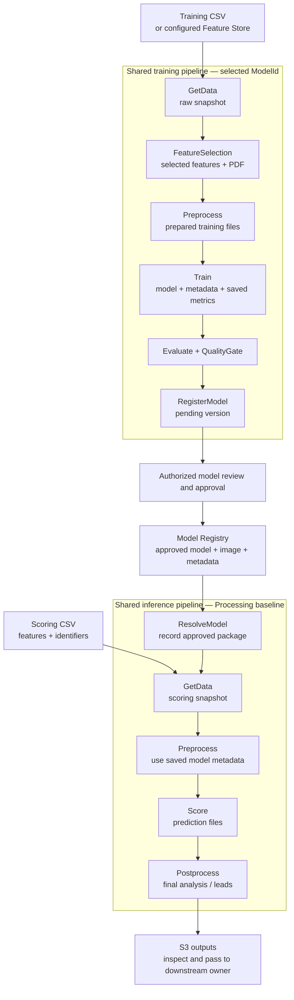
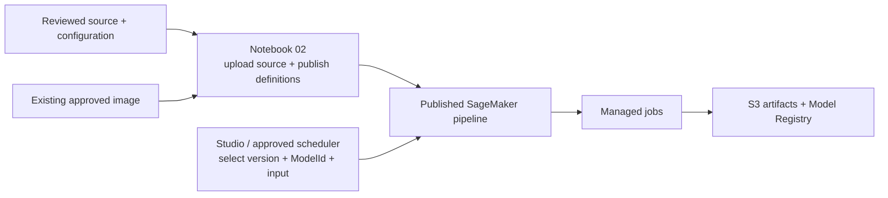

# Enterprise MLOps — training and batch prediction

This first handoff explains how to use the existing SageMaker pipelines, follow
their outputs and read the code. The receiving team reports that training and
batch inference are working. Use that deployment for the initial walkthrough
and testing; source review and repository commits are separate from publishing
a new pipeline version.

The application has **one shared training pipeline and one shared inference
pipeline**. Each execution selects its model through `ModelId`. Model Registry
connects training to inference: training registers a candidate, an authorized
reviewer approves a version, and inference loads an approved model.

**MLflow is optional and defaults off.** An MLflow service is not required for
this first handoff. The source includes basic tracking support for later
activation. The [remaining integration plan](docs/integration/README.md) covers
service setup, tracking completion, Evidently reports, alerts and the wider
platform work.

| I want to… | Start here |
| --- | --- |
| Inspect or run the existing deployment | [Use the existing pipelines](#use-the-existing-pipelines) |
| Understand the steps and data flow | [How the application works](#how-the-application-works) |
| Find the code for a step or model | [Read the code](#read-the-code) |
| Review the latest shared-code additions | [What this source includes](#what-this-source-includes) |
| Publish a changed version or adapt model code | [Implementation reference](docs/implementation/README.md) |
| Agree what happens after this handoff | [Integration plan and walkthrough decisions](docs/integration/README.md) |

## Use the existing pipelines

Obtain the current deployment's account/Region, training and inference pipeline
names, accepted version numbers, available `ModelId` values and Registry groups
from the deployment owner. Use the actual deployed values; names shown in source
examples are not receiving-environment bindings.

**To inspect the working example**, open SageMaker Studio → Pipelines and select
a completed execution. Review its effective parameters, step graph, jobs and
outputs. Follow its registered model version into the inference execution.
You can complete this walkthrough without starting jobs.

**To test with an existing approved model**, start at step 3 below. A new scoring
batch does not require another training run.

1. **Train when a new candidate is needed.** Open the existing training pipeline,
   select the accepted published version and set `ModelId` and `CsvInputUri` to
   the intended model and training CSV. Use the deployment's existing settings.
   Training data must contain the columns and target required by that model.
2. **Review the candidate.** After Evaluate, QualityGate and RegisterModel
   succeed, open the resulting version in Model Registry. Registration creates
   a pending version. An authorized reviewer inspects its metrics/artifacts and
   approves it when appropriate.
3. **Run batch inference.** Open the existing inference pipeline with the same
   `ModelId` and the scoring `CsvInputUri`. Where `InferenceRuntime` is exposed,
   use `processing` for the baseline. ResolveModel selects the highest numeric
   Completed, Approved version and records the exact package used. Scoring
   inputs need model features and identifiers; a target is not required.
4. **Inspect results.** Open the producing Postprocess job's S3 output. Check the
   final analysis, row identifiers/counts and expected result columns. Retain
   the execution ARN, model-package ARN and output URI with the test result.

The templates name final outputs `prediction_analysis.csv` and `summary.json`.
Adapted model code may produce additional lead or analysis files; inspect its
actual output directory. Registry errors or missing approval stop inference.

| Question | Where to look |
| --- | --- |
| Which model, data and settings did this execution use? | Pipeline execution parameters; ResolveModel's `package.json` for the selected package/image/artifact |
| What ran, failed or reused cached results? | Execution step details and linked Training/Processing jobs |
| Where are the fitted model and evaluation? | Registered version's model-data and evaluation references |
| Where are predictions and final analysis? | Score and Postprocess job output S3 locations |
| Why did a step fail? | The first failed step, its failure reason and complete CloudWatch job logs |

An unchanged repeat can reuse successful compute outputs. Follow the **actual
producer's** job/output location shown by the cached step. A new execution folder
can contain only a registration receipt while its data/model/reports remain
under an older execution. A simpler per-run artifact index is follow-on work.

For complete logs, use the existing
[job-log helper](mlops-models/scratch/job_log_cell.py) with the linked job name.
It reads logs without restarting the job. The
[artifact and cache reference](docs/implementation/README.md#local-paths-and-s3-artifacts)
explains the detailed layout and producer links.

## How the application works

Each step reads completed files from its upstream producer, calls the selected
model function and writes outputs for the next step.

Feature selection also consumes the raw snapshot; training preprocessing receives
both raw data and selected features. Train receives the prepared files and
selection. Inference postprocessing receives raw data, saved selection and
predictions. Those separate handoffs preserve the inputs needed by model code.

Model parameters live in `models/<ModelId>/parameters.json`. Learned information
travels with the saved model in `model_metadata.json` and any fitted objects.
Inference uses that registered model's learned state. The
[detailed contracts](docs/implementation/README.md#pipeline-and-data-contracts)
describe the exact function arguments and files.

The supplied `usecase1` regression and `usecase2` binary-classification folders are
replaceable examples. Their prepared-input evaluation is a workflow smoke check;
model owners supply real validation and acceptance thresholds.

Native Batch Transform is an optional inference branch with its own image/startup
acceptance. HPO and Feature Store are also separate acceptance items. The initial
walkthrough follows the receiving team's working training/Processing path.

## Source publication and pipeline execution

**For today's walkthrough, enter through the existing published pipeline.**
Notebook 01 prepares sample data or performs configured ingestion. Notebook 02
uploads source and publishes definitions; these are preparation/release
operations. Running either notebook is not required to inspect or start an
already deployed pipeline.

A Git commit or pull request records source; it does not update SageMaker or
rebuild an image. A source change reaches runtime through a deliberate upload
and publication. The approved image supplies dependencies separately. Retain
the actual deployed source/image identity rather than assuming the newest
repository commit produced an old execution.

When a new deployment is intended, follow the
[notebook publication guide](docs/implementation/README.md#run-the-two-notebooks).
Keep existing environment configuration and adapted model code.

## Read the code

Follow this chain for any Processing or ordinary Training step:

`published definition → runtime loader → entrypoint → selected model function → files`

| Read here | What it does |
| --- | --- |
| [Pipeline builder](mlops-models/src/mlops_models/pipelines/source.py) | Builds the shared graphs, input/output references and optional branches |
| [Training step definitions](mlops-models/src/mlops_models/pipelines/training_files.py) | Wires raw, selection and prepared-data handoffs |
| [Runtime loader](mlops-models/src/mlops_models/runtime/load_source.py) | Locates source/model files, provides writable paths, dispatches a step and uploads its outputs |
| [Entrypoint dispatcher](mlops-models/src/mlops_models/entrypoints/__main__.py) | Selects the step's `execute()` function |
| [Per-model folders](mlops-models/src/mlops_models/models) | Model-specific parameters and training/inference overrides |
| [Model base](mlops-models/src/mlops_models/model_base) | Shared example implementations that model code replaces or extends |
| [Registry operations](mlops-models/src/mlops_models/registry/model_package.py) | Registers versions and resolves approved models |
| [Optional tracking](mlops-models/src/mlops_models/pipelines/tracking.py) | Collects execution/producer records and writes them to MLflow |

Model scripts retain **read inputs → model code → write outputs**. The
orchestration supplies paths and configuration. Start with one execution's step
and follow its entrypoint into the matching model folder; the
[implementation reference](docs/implementation/README.md#execution-and-code-map)
covers overrides, archived source and file contracts.

## What this source includes

The latest shared additions leave model algorithms unchanged:

| Addition | Value for the handoff |
| --- | --- |
| Configured temporary directory | The loader honors the image's `TMPDIR`, allowing the approved non-root user to use owned writable scratch |
| Producer records beside outputs | `_execution.json` records source, execution and settings, including when later runs reuse cached artifacts |
| Evaluation support files | Publishes available saved training parameters and producer metadata with evaluation; older packages may omit those records |
| Optional MLflow integration | Adds tracking jobs and notebook synchronization only when tracking is configured; includes the scoped job-name and optional KMS-value fixes |

Keep `"tracking_uri": ""` in the source configuration until an approved service,
compatible clients, connectivity and caller permissions are ready. With tracking
off, the builder adds no tracking jobs and makes no MLflow connection. Existing
published pipelines retain their own configuration until deliberately republished.

Basic tracking has managed training and cached-repeat evidence in the sandbox.
Receiving-environment MLflow acceptance remains open. Automatic final-status
updates, the per-run S3 index, Evidently reports and alerts are in the
[post-handoff plan](docs/integration/README.md); they are not first-handoff gates.

## First walkthrough and feedback

Use one completed training execution and its approved model/inference example:

1. Confirm model/input/version, then follow raw data through training to Registry.
2. Follow the approved model and scoring input through inference to final output.
3. Open one entrypoint and its model function; identify the input/output contract.
4. Inspect a cache hit or a failed step and its producer/log links.
5. Record the receiving team's test findings and assign the open
   [platform and integration decisions](docs/integration/README.md#decisions-for-the-walkthrough).

First-handoff acceptance is that another engineer can find the working pipelines,
understand and test the supported path, locate outputs/logs and identify the code
to change. Record per-model results and the accepted source/deployment identities
inside the receiving environment. Remaining feature and production acceptance
continues through the integration plan.
