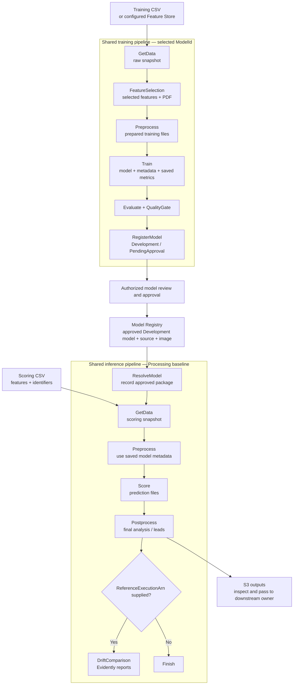
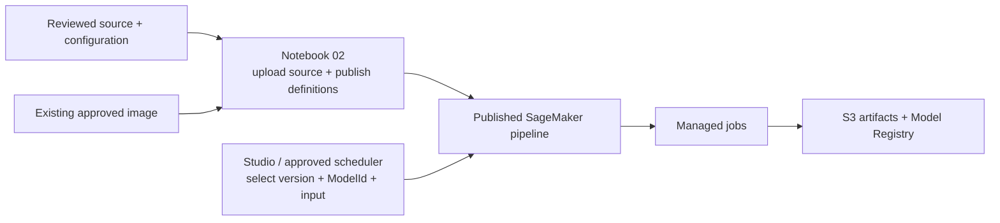

# Enterprise MLOps — training and batch prediction

This first handoff explains how to use the existing SageMaker pipelines, follow
their outputs and read the code. The receiving team reports that training and
batch inference are working. Use that deployment for the initial walkthrough
and testing; source review and repository commits are separate from publishing
a new pipeline version.

The application has **one shared training pipeline and one shared inference
pipeline**. Each execution selects its model through `ModelId`. Model Registry
connects training to inference: notebook training registers a Development version,
an authorized reviewer approves it, and inference selects it within that
deployment namespace. The future CDK/CI route will register ProductionCandidate
versions in the same existing group; that integration remains platform work.

**MLflow is optional and defaults off.** An MLflow service is not required for
this first handoff. The source includes basic tracking support for later
activation. The [remaining integration plan](docs/integration/README.md) covers
service setup, tracking completion, Evidently reports, alerts and the wider
platform work.

| I want to… | Start here |
| --- | --- |
| Inspect or run the existing deployment | [Use the existing pipelines](#use-the-existing-pipelines) |
| Understand the steps and data flow | [How the application works](#how-the-application-works) |
| Find the code for a step or model | [Read the code](#read-the-code) |
| Review the latest shared-code additions | [What this source includes](#what-this-source-includes) |
| Publish a changed version or adapt model code | [Implementation reference](docs/implementation/README.md) |
| Agree what happens after this handoff | [Integration plan and walkthrough decisions](docs/integration/README.md) |

## Use the existing pipelines

Obtain the current deployment's account/Region, training and inference pipeline
names, accepted version numbers, available `ModelId` values and Registry groups
from the deployment owner. Use the actual deployed values; names shown in source
examples are not receiving-environment bindings.

**To inspect the working example**, open SageMaker Studio → Pipelines and select
a completed execution. Review its effective parameters, step graph, jobs and
outputs. Follow its registered model version into the inference execution.
You can complete this walkthrough without starting jobs.

**To test with an existing approved model**, start at step 3 below. A new scoring
batch does not require another training run.

1. **Train when a new Development model is needed.** Open the existing training pipeline,
   select the accepted published version and set `ModelId` and `CsvInputUri` to
   the intended model and training CSV. Choose `TrainingMode` and, optionally,
   supply a model metadata JSON file through `ModelMetadataUri` as described below.
   Training data must contain the columns and target required by that model.
2. **Review the Development version.** After Evaluate, QualityGate and RegisterModel
   succeed, open the resulting version in Model Registry. Check its namespace and
   outputs. Set model approval to `Approved` and lifecycle to
   `Development / Approved`. Notebook 02 includes an optional exact-version cell
   that updates both fields together after review.
3. **Run batch inference.** Open the existing inference pipeline with the same
   `ModelId` and the scoring `CsvInputUri`. Where `InferenceRuntime` is exposed,
   use `processing` for the baseline. ResolveModel selects the highest numeric
   Completed, Approved version with lifecycle `Development / Approved` and matching
   namespace, environment and ModelId. Set `ModelPackageArn` to replay an exact
   version with those same checks. Other namespaces and ProductionCandidate
   versions are excluded. Leave `ModelMetadataUri=registry` to use that model's
   metadata, or supply an S3 JSON URI to override metadata for this execution. Scoring
   inputs need model features and identifiers; a target is not required.
4. **Inspect results.** Open the producing Postprocess job's S3 output. Check the
   final analysis, row identifiers/counts and expected result columns. Retain
   the execution ARN, model-package ARN and output URI with the test result.

`TrainingMode` and `ModelMetadataUri` are independent execution inputs:

| TrainingMode | ModelMetadataUri | Trainer input |
| --- | --- | --- |
| `Preliminary models with validation` (default) | `none` (default) | `MLOPS_TRAINING_MODE="1"`, `config={}` |
| `Preliminary models with validation` | `s3://bucket/path/model_metadata.json` | `MLOPS_TRAINING_MODE="1"`, supplied JSON as `config` |
| `Final model with all data` | `none` | `MLOPS_TRAINING_MODE="2"`, `config={}` |
| `Final model with all data` | `s3://bucket/path/model_metadata.json` | `MLOPS_TRAINING_MODE="2"`, supplied JSON as `config` |

The entrypoint converts the readable selection before calling model code.
Inside the trainer, `mode = os.getenv("MLOPS_TRAINING_MODE", "1")` returns `"1"`
or `"2"`. Mode stays separate from the parameters and hyperparameters dictionaries.
The demo's preliminary mode fits with
validation; final mode refits the selected model on all training and validation
rows. Custom trainers own their implementation of those two choices and their
interpretation of supplied metadata. Metadata remains optional in both modes.
`UseHPO`, when published, is a separate choice; its validation objective still
comes from a model fitted with validation.

For inference, the selected Registry model remains the source of fitted weights,
saved parameters and image. A metadata override replaces the complete JSON
document for the execution. ResolveModel writes a separate model archive under
its output prefix, changing only `model_metadata.json`; it leaves the Registry
version and original artifact unchanged. `package.json` records the original
artifact, override URI and checksum. The override must match the fitted model's
features and preprocessing. This works with Processing and native Transform.

Use a complete S3 object URI, not a local filename or folder. The job role needs
read access to the object and its encryption key, and the container needs S3
connectivity. Keep each supplied metadata object immutable under its own key:
training can reuse cached results for an unchanged URI, and preprocessing and
training read that same URI independently. Invalid or inaccessible JSON fails
instead of silently falling back. Keep the named defaults in Studio rather than
clearing the fields.

These fields appear after publishing the updated source with notebook 02 and
selecting the resulting pipeline version. Copying Python files alone does not
update an already-published execution form.

The templates name final outputs `prediction_analysis.csv` and `summary.json`.
Adapted analysis writes its own files into the supplied output directory:
plots, metrics and lead files retain their names and subfolders in S3.
It need not return a dataframe or create those demo filenames. Registry errors
or missing approval stop inference. The [analysis call flow and file inputs](docs/implementation/README.md#how-the-analysis-is-called)
show where to connect the model's prediction-analysis function.

| Question | Where to look |
| --- | --- |
| Which model, data and settings did this execution use? | Pipeline execution parameters; ResolveModel's `package.json` for the selected package/image/artifact |
| What ran, failed or reused cached results? | Execution step details and linked Training/Processing jobs |
| Where are the fitted model and evaluation? | Registered version's model-data and evaluation references |
| Where are predictions and final analysis? | Score and Postprocess job output S3 locations |
| Why did a step fail? | The first failed step, its failure reason and complete CloudWatch job logs |

An unchanged repeat can reuse successful compute outputs. Follow the **actual
producer's** job/output location shown by the cached step. A new execution folder
can contain only a registration receipt while its data/model/reports remain
under an older execution. Processing inference always runs Postprocess, which
writes `run.json` with the original producer/output links. The completion Lambda finalizes that
report from native execution status; MLflow is optional.

For complete logs, use the existing
[job-log helper](mlops-models/scratch/job_log_cell.py) with the linked job name.
It reads logs without restarting the job. The
[artifact and cache reference](docs/implementation/README.md#local-paths-and-s3-artifacts)
explains the detailed layout and producer links.

## How the application works

Each step reads completed files from its upstream producer, calls the selected
model function and writes outputs for the next step.



Feature selection also consumes the raw snapshot; training preprocessing receives
both raw data and selected features. Train receives the prepared files and
selection. Inference postprocessing receives raw data, saved selection and
predictions. Those separate handoffs preserve the inputs needed by model code.

Model parameters live in `models/<ModelId>/parameters.json`. Learned information
travels with the saved model in `model_metadata.json` and any fitted objects.
Inference uses that registered model's learned state. The
[detailed contracts](docs/implementation/README.md#pipeline-and-data-contracts)
describe the exact function arguments and files.

The supplied `usecase1` regression and `usecase2` binary-classification folders are
replaceable examples. Their prepared-input evaluation is a workflow smoke check;
model owners supply real validation and acceptance thresholds.

Native Batch Transform is an optional inference branch with its own image/startup
acceptance. HPO and Feature Store are also separate acceptance items. The initial
walkthrough follows the receiving team's working training/Processing path.

## Source publication and pipeline execution



**For today's walkthrough, enter through the existing published pipeline.**
Notebook 01 prepares sample data or performs configured ingestion. Notebook 02
uploads source and publishes definitions; these are preparation/release
operations. Running either notebook is not required to inspect or start an
already deployed pipeline.

A Git commit or pull request records source; it does not update SageMaker or
rebuild an image. A source change reaches runtime through a deliberate upload
and publication. The approved image supplies dependencies separately. Retain
the actual deployed source/image identity rather than assuming the newest
repository commit produced an old execution. Source publication uses a content
digest and conditional S3 writes: changing code creates a new source location,
while reusing a `deploy_name` cannot overwrite the old source through this
publisher. Repeating an identical upload verifies/reuses the existing files.
Notebook-uploaded CSVs similarly use their existing checksum in the destination.
Externally supplied data locations retain their owner's update policy.

With notebook caching enabled, each compute step resolves an immutable source
binding based on its code fingerprint. A registry-only edit keeps the existing
source URI for GetData, FeatureSelection, Preprocess, Train and Evaluate; registration
uses the new publication. An edit to a step's own code changes its binding, and
changed upstream outputs still invalidate downstream consumers. Shared runtime
and logging changes refresh the steps that execute them.

Notebook 02 prints each step's selected source and saves the bindings in
`publication.json`. A retained source URI is expected when the relevant code is
unchanged. Full source snapshots and their original provenance remain intact.
The first publication using these bindings establishes a new cache baseline.
Keep the retained source objects and binding records under the deployment prefix.
The pipeline execution role needs `s3:GetObject` on the binding JSON objects under
the existing source prefix; job roles need read access to the retained snapshots.

The 24-hour cache still requires an earlier successful matching step in the same
pipeline. Changed data, model selection, execution inputs, image or job settings
can require a rerun. Concurrent unfinished jobs are not reusable cached results.

When a new deployment is intended, follow the
[notebook publication guide](docs/implementation/README.md#run-the-two-notebooks).
Keep existing environment configuration and adapted model code.

## Notebook isolation and the future CDK route

Notebook 02 generates a namespace on first use and saves it in
`notebooks/config.json`; subsequent runs reuse it. Supply an explicit namespace
for an existing deployment. Each person uses their own config/namespace, while
model versions remain in the existing shared Registry group.

Training retains the source snapshot, including uncommitted model code and the
existing metadata input. The registered version links its source URI/digest,
commit, image digest and trained artifacts. All Processing inference steps,
including GetData, Postprocess and optional DriftComparison, use that model's saved release. Train and
approve a new version to test changed inference code. Retain its S3 source/model
objects and ECR image for replay; code pinning does not make randomized training
deterministic. Older versions without namespace and source metadata stay untouched
and require new training before these new pipelines can select them.

| Deployment route | Registration stage | Current scope |
| --- | --- | --- |
| Notebook, isolated namespace | Development / PendingApproval | Implemented; approve within Development and run inference in that namespace |
| Trusted CDK/CI pipeline | ProductionCandidate / PendingApproval | Platform integration to implement; no notebook switch enables it |

For the CDK route, agree a protected CI build from the merge commit, an immutable
source release and image digest, a dedicated registration role, and restrictions
on pipeline updates, role passing and Registry stage transitions. A notebook
parameter or editable environment variable is not that permission boundary.
The production candidate must come from a new training execution of the trusted
pipeline, rather than relabeling a notebook model. Account/environment names are
separate from the lifecycle stage.

## Read the code

Follow this chain for any Processing or ordinary Training step:

`published definition → runtime loader → entrypoint → selected model function → files`

| Read here | What it does |
| --- | --- |
| [Pipeline builder](mlops-models/src/mlops_models/pipelines/source.py) | Builds the shared graphs, input/output references and optional branches |
| [Training step definitions](mlops-models/src/mlops_models/pipelines/training_files.py) | Wires raw, selection and prepared-data handoffs |
| [Runtime loader](mlops-models/src/mlops_models/runtime/load_source.py) | Locates source/model files, provides writable paths, dispatches a step and uploads its outputs |
| [Entrypoint dispatcher](mlops-models/src/mlops_models/entrypoints/__main__.py) | Selects the step's `execute()` function |
| [Per-model folders](mlops-models/src/mlops_models/models) | Model-specific parameters and training/inference overrides |
| [Model base](mlops-models/src/mlops_models/model_base) | Shared example implementations that model code replaces or extends |
| [Registry operations](mlops-models/src/mlops_models/registry/model_package.py) | Registers versions and resolves approved models |
| [Optional tracking](mlops-models/src/mlops_models/pipelines/tracking.py) | Logs directly from existing jobs; the completion Lambda finalizes native status and cached-producer references |

Model scripts retain **read inputs → model code → write outputs**. The
orchestration supplies paths and configuration. Start with one execution's step
and follow its entrypoint into the matching model folder; the
[implementation reference](docs/implementation/README.md#execution-and-code-map)
covers overrides, archived source and file contracts.

Drift follows the same chain: `entrypoints/drift.py` calls
`models/<ModelId>/inference/drift.py`, which defaults to
`model_base/inference/drift.py`. The base module owns `get_container_input()`,
the comparison/report calls in `compare_drift()`, and `write_container_output()`.
Customize the use-case module to change that model's comparison workflow.
Drift code is saved with the trained model; changing it also invalidates the
training cache so the next model archive includes the updated implementation.

## What this source includes

The latest shared additions leave model algorithms unchanged:

| Addition | Value for the handoff |
| --- | --- |
| Configured temporary directory | The loader honors the image's `TMPDIR`, allowing the approved non-root user to use owned writable scratch |
| Producer records beside outputs | `_execution.json` records source, execution and settings, including when later runs reuse cached artifacts |
| Evaluation support files | Publishes available saved training parameters and producer metadata with evaluation; older packages may omit those records |
| Optional MLflow integration | Existing jobs log to one shared execution run when configured; no tracking-only jobs are added |
| Analysis metrics and reports | Optional `metrics.json` publishes prediction metrics; selection outputs and HTML/JSON reports are visible alongside evaluation |
| Run index and final status | EventBridge and the completion Lambda finalize the run from native status and write the run-folder index; cached outputs retain their original producers |
| Batch monitoring | The HasReference gate runs DriftComparison only when `ReferenceExecutionArn` is supplied; compares saved inputs/scores and publishes Evidently reports in the same inference MLflow run |

Keep `"tracking_uri": ""` in the source configuration until an approved service,
compatible clients, connectivity and caller permissions are ready. With tracking
off, the jobs make no MLflow connection. The pipeline graph is the same with tracking on or off. Existing
published pipelines retain their own configuration until deliberately republished.

To use an existing MLflow Tracking Server or App, set just this field in your
existing `notebooks/config.json` (keep its other values):

```json
{"tracking_uri": "arn:aws:sagemaker:REGION:ACCOUNT:mlflow-tracking-server/NAME"}
```

An App ARN uses `mlflow-app/NAME` instead. Notebook 02 derives experiment names
from the existing namespace and obtains artifact locations from the service.
For a Tracking Server, it describes the server in the ARN's Region and checks
that it is active. For either service, it uses the installed client to verify
parameters, metrics, tags, dataset references, run search and artifact
upload/download in a labelled `connection-check` run in each model experiment.
The checks remain visible, and `publication.json` records their IDs and observed
client/server versions. An empty `tracking_uri` skips all MLflow connections.

Use the MLflow client and `sagemaker-mlflow` plugin already supplied by the
notebook and job images. The integration does not require equal notebook, job
and server versions, install packages or change those images. An actual API or
access failure stops the check with the failed operation and original error.
Notebook success does not prove job-image compatibility, job-role, network or
UI access; verify an actual execution in the supplied image.

Use the [managed MLflow integration guide](docs/integration/mlflow-app.md) for
caller permissions and activation with notebook 02.

The [logging and monitoring guide](docs/integration/observability.md) explains the
run ID, finalization call and report locations. The image build uses the root
`requirements.txt` and its resolved lock for model jobs, MLflow and Evidently.
The model-library versions remain pinned. Evidently requires the documented
`requests` update from 2.31.0 to 2.34.2; apply that through the approved image build.
BMO extends its scheduling, model-quality analysis and response integration.

Enable `monitoring` in notebook 02 once Evidently is available in the approved
image. Run inference in Studio first without a reference, then again with
that successful execution's ARN. HasReference skips the DriftComparison job when
no reference is supplied; Postprocess still writes prediction analysis and run.json.
With a reference, DriftComparison uses the same saved model source/image and writes
`reports/drift/monitoring/` under the current run folder. MLflow artifacts appear
under `outputs/DriftComparison/monitoring/`. Missing outcomes mean quality is unavailable.
The reference's job-written run.json identifies its actual cached producers,
independently of MLflow. An invalid supplied reference fails the comparison. Use the same model version for the first
comparison. Model owners configure the prediction CSV/score column and drift
thresholds; shared code aligns records by the configured primary key.

## First walkthrough and feedback

Use one completed training execution and its approved model/inference example:

1. Confirm model/input/version, then follow raw data through training to Registry.
2. Follow the approved model and scoring input through inference to final output.
3. Open one entrypoint and its model function; identify the input/output contract.
4. Inspect a cache hit or a failed step and its producer/log links.
5. Record the receiving team's test findings and assign the open
   [platform and integration decisions](docs/integration/README.md#decisions-for-the-walkthrough).

First-handoff acceptance is that another engineer can find the working pipelines,
understand and test the supported path, locate outputs/logs and identify the code
to change. Record per-model results and the accepted source/deployment identities
inside the receiving environment. Remaining feature and production acceptance
continues through the integration plan.

## Automatic execution completion

Only notebooks 01 (data preparation) and 02 (deployment) are used. No notebook or
launcher process must run after a pipeline execution. When completion_code_uri is
supplied, notebook 02 deploys a completion Lambda, a terminal EventBridge rule, a five-minute reconciliation rule
and an error alarm before publishing the pipelines. Succeeded, Failed, Stopped and
cached executions are finalized using native execution records. Failed publication
is retried; the reconciliation schedule covers missed events.

Leave completion_code_uri empty to skip service deployment while Platform prepares it.
This does not remove an existing service. Jobs still produce S3 outputs, register
models and log directly to MLflow when configured. Without the service, terminal
MLflow status and the final consolidated report are not automatic; inspect native
SageMaker status. Postprocess still writes its initial run.json. With tracking_uri
empty too, jobs run without MLflow. An inaccessible configured tracker fails visibly.

Build the Lambda ZIP using `operations/completion/build.py` inside the same approved
Linux x86_64 Python 3.12 image. It copies the installed MLflow client dependencies;
it does not create another image or install different package versions. Upload it
to an immutable S3 key and set `completion_code_uri` in notebook configuration.
Deployment rejects a ZIP containing different reporting/handler source.

The Platform deployment needs CloudFormation, IAM, Lambda and EventBridge access.
The runtime role needs the configured pipeline/job reads, project-output S3 access,
MLflow API access, and S3 writes to the selected experiments' artifact locations.
Notebook 02 resolves those locations when preparing the experiments. Platform can
express the supplied template in its CDK constructs and add its required network,
KMS and permission-boundary settings. The model jobs continue using one image.

## Feature counts

Notebook 01 normally generates one column per unique supplied metadata definition,
excluding generated ID/time keys. Set `demo_10000_features=True` in its Defaults cell
for an explicit synthetic width demonstration. It generates metadata for 10,000
predictors plus the target for `demo_model_id` (usecase2 by default), then uses the
same sample-generation path. Choose that ModelId when executing training.

Both example configurations now consider every predictor except ID, timestamp and
target. FeatureSelection fits those candidates, saves `selection/metrics.json` with
actual input/candidate/selected counts, and retains up to `feature_selection.top_k`
(50 by default). Preprocess passes only those selected columns, keys and target to
Train. Direct MLflow logging exposes `selection.candidate_features` and
`selection.selected_features` using the existing metrics reader. An explicit customer
`features` list still constrains selection. The generated sample repeats five reference
patterns; it demonstrates feature width and artifact flow, not model quality.
