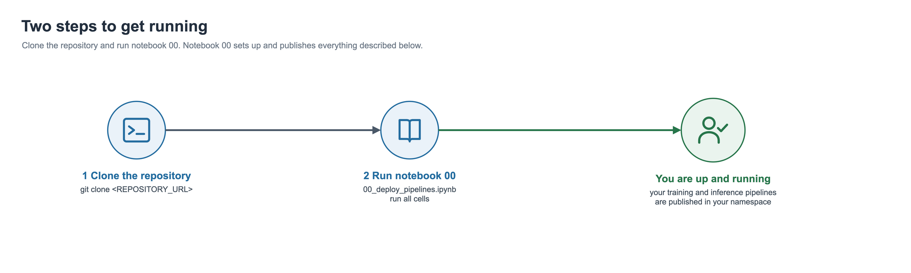
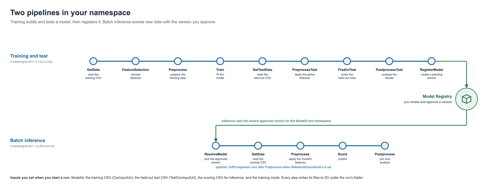
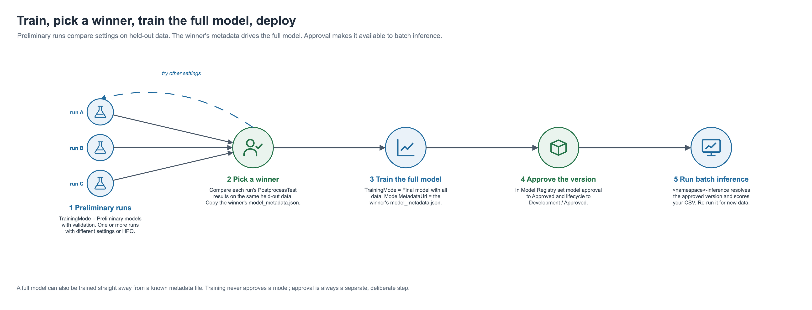
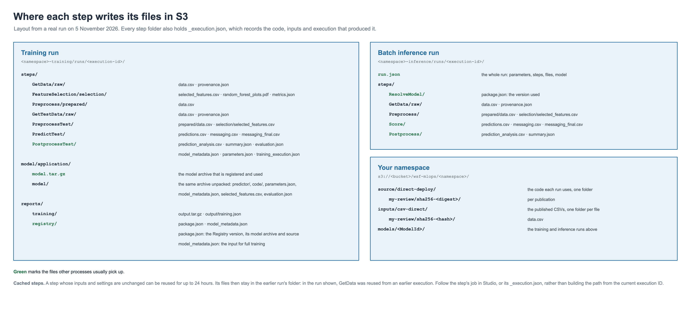
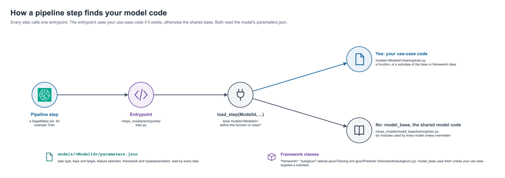
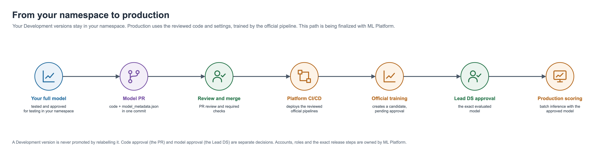

# Training and batch inference pipelines on SageMaker

Train, test and run batch inference for your models with SageMaker pipelines,
started from SageMaker Studio.

## Quick start



**1. Clone the repository** in a terminal in your SageMaker Studio space:

```bash
git clone <REPOSITORY_URL>
```

**2. Run notebook 00.** Open `notebooks/00_deploy_pipelines.ipynb` and run all
cells.

That's it. These two steps deploy everything described below: your namespace,
its input data and your training and batch inference pipelines. **You are now up
and running.** Start a training run from Studio: **Pipelines →
`<namespace>-training` → Create execution**.

Read on to see how it works.

## Contents

1. [What you deploy](#1-what-you-deploy)
2. [What notebook 00 sets up](#2-what-notebook-00-sets-up)
3. [Train and deploy a model](#3-train-and-deploy-a-model)
4. [Outputs: where every file lands and how to pick it up](#4-outputs-where-every-file-lands-and-how-to-pick-it-up)
5. [Notebooks at a glance](#5-notebooks-at-a-glance)
6. [Your model code and how to change it](#6-your-model-code-and-how-to-change-it)
7. [From your namespace to production](#7-from-your-namespace-to-production)
8. [Appendix](#8-appendix): configuration, experiment tracking, drift, Feature
   Store, troubleshooting and terms

---

## 1. What you deploy



| Pipeline | Name in Studio | Steps |
| --- | --- | --- |
| Training and test | `<namespace>-training` | GetData → FeatureSelection → Preprocess → Train → GetTestData → PreprocessTest → PredictTest → PostprocessTest → RegisterModel |
| Batch inference | `<namespace>-inference` | ResolveModel → GetData → Preprocess → Score → Postprocess, plus an optional DriftComparison |

- **Training** fits the model on the training CSV. It then tests that same model
  on a separate held-out CSV and registers a new version in Model Registry,
  pending approval.
- **Batch inference** picks the newest version you approved, prepares the
  scoring CSV the same way and writes predictions.
- **One pipeline pair serves every model.** The `ModelId` parameter (`usecase1`,
  `usecase2`, …) selects the model's code and settings for a run.
- **Your namespace is your own.** Your runs, outputs and registered versions carry
  it, and inference only selects versions from your namespace.

## 2. What notebook 00 sets up

Notebook 00 is the only setup you run. It:

1. loads the platform settings (bucket, roles, container image, Registry
   group prefix). If `notebooks/config.json` is incomplete, it reads them from the
   AWS Secrets Manager secret `wsf-mlops-setup`.
2. creates your namespace the first time and saves it in `notebooks/config.json`.
   The name is `wsf-` + the first seven characters of your Studio user name + `-` +
   an eight-character hash, for example `wsf-jsmith-1a2b3c4d`.
3. reuses the configured datasets, or prepares sample data if none are configured
   (`DATA_MODE = "auto"`)
4. publishes the code and the CSVs to S3 and creates or updates
   `<namespace>-training` and `<namespace>-inference`

It prints the namespace, the published S3 paths and the pipeline names and
versions. It saves a full report under `.runs/setup/deploy-<timestamp>/`. It does
not start training or approve models.

> Re-run notebook 00 whenever you change model code or `parameters.json`. A run
> uses the code published with its pipeline version; runs already started keep
> theirs.

---

## 3. Train and deploy a model



### Step 1: preliminary runs

Start `<namespace>-training`. These are the parameters you normally set:

| Parameter | Default | Set to |
| --- | --- | --- |
| `ModelId` | first model | the model to train, from the drop-down |
| `TrainingMode` | `Preliminary models with validation` | keep the default |
| `ModelMetadataUri` | `none` | keep `none`; preliminary runs ignore it |
| `CsvInputUri` | the published training CSV | another training CSV, if you want |
| `TestCsvInputUri` | the published held-out CSV | another labelled held-out CSV, if you want |
| `PrepareInstanceType`, `PreprocessInstanceType`, `TrainInstanceType`, `PostprocessInstanceType` | `ml.m5.large` | a larger instance for larger data |

Leave `PipelineSourceUri`, `OutputDataRoot`, `PipelineName` and `BatchChunkRows`
as published.

Run as many preliminary runs as you need, changing settings in the model's
`parameters.json` (re-run notebook 00 after each change) or the input data. Each
run trains, tests on the held-out CSV and registers a pending version.

### Step 2: pick a winner

Compare the runs' `steps/PostprocessTest/` output on the held-out data (section
4). The example models write their predictions to `prediction_analysis.csv` and
leave the `metrics` block in `evaluation.json` empty. Your model's
`prediction_test` function decides what analysis and metrics appear there.

Copy the winner's metadata URI. For example, from a real run:

```text
s3://<bucket>/wsf-mlops/<namespace>/models/usecase1/<namespace>-training/runs/61i8exal85y6/reports/registry/model_metadata.json
```

### Step 3: train the full model

Start `<namespace>-training` again:

| Parameter | Set to |
| --- | --- |
| `ModelId` | the same model |
| `TrainingMode` | `Final model with all data` |
| `ModelMetadataUri` | the winner's `model_metadata.json` URI |

Full training refits the selected model on the training and validation rows. It
stops before fitting if `ModelMetadataUri` is `none`, empty or unreadable, with
the message *"Final model with all data requires ModelMetadataUri"*.

### Step 4: approve the version

Every training run registers a version with model approval
`PendingManualApproval` and lifecycle `Development / PendingApproval`. In
Studio, open **Models → Registered models**. Open your model's group
(`<registry_group_prefix><ModelId>-sm-dev`) and the version from the full run.
Then set **both**:

- **Model approval:** `Approved`
- **Lifecycle:** stage `Development`, status `Approved`

Notebook 02 has an optional cell that does this for one exact version.

### Step 5: run batch inference

Start `<namespace>-inference`:

| Parameter | Default | Meaning |
| --- | --- | --- |
| `ModelId` | first model | the model to score with |
| `CsvInputUri` | the published scoring CSV | the rows to score: identifiers and features; no target needed |
| `ModelPackageArn` | `latest-approved` | or the exact ARN of one approved version |
| `ModelMetadataUri` | `registry` | use the model's own metadata |
| `ModelCodeSource` | `artifact` | `artifact` runs the code saved with the model; `pipeline` runs the currently published code |
| `ReferenceExecutionArn` | `none` | an earlier inference execution, to run the drift comparison |

ResolveModel goes through the group's `Approved` versions from newest to oldest.
It uses the first one that is `Completed` and `Development / Approved`, and that
matches your namespace, `ModelId` and environment. An explicit
`ModelPackageArn` must pass the same checks. If nothing qualifies, the run stops
with *"No eligible Development model…"*; it never falls back to another
namespace's model.

> **Prefer a notebook?** `notebooks/04_run_and_monitor.ipynb` starts the same runs
> (`PIPELINE_KIND = "training"` or `"inference"`). It can also check status, list
> each job's actual output locations, wait or stop.

---

## 4. Outputs: where every file lands and how to pick it up



The layouts below were read from real runs on 5 November 2026: a preliminary
training run, a full training run and a batch inference run of `usecase1`.

### 4.1 Your namespace in S3

```text
s3://<bucket>/wsf-mlops/<namespace>/
├── source/direct-deploy/my-review/sha256-<digest>/      one folder per code publication
│   ├── load_source.py                                  the step bootstrap
│   ├── source.json                                     commit, digest, publication name
│   └── mlops_models/                                   the application code the jobs run
├── inputs/csv-direct/my-review/sha256-<file-hash>/data.csv
│                                                       published training, held-out and scoring CSVs
└── models/<ModelId>/
    ├── <namespace>-training/runs/<execution-id>/       one folder per training run (4.2)
    └── <namespace>-inference/runs/<execution-id>/      one folder per inference run (4.3)
```

The execution ID is the last part of the run's ARN, shown on the run's page in
Studio, for example `61i8exal85y6`.

### 4.2 A training run

```text
<namespace>-training/runs/<execution-id>/
├── steps/
│   ├── GetData/          raw/data.csv, raw/provenance.json
│   ├── FeatureSelection/ selection/selected_features.csv, selection/random_forest_plots.pdf,
│   │                     selection/metrics.json
│   ├── Preprocess/       prepared/data.csv
│   ├── GetTestData/      raw/data.csv, raw/provenance.json
│   ├── PreprocessTest/   prepared/data.csv, selection/selected_features.csv
│   ├── PredictTest/      predictions.csv, messaging.csv, messaging_final.csv
│   └── PostprocessTest/  prediction_analysis.csv, summary.json, evaluation.json,
│                         model_metadata.json, parameters.json, training_execution.json
├── model/application/
│   ├── model.tar.gz      the model archive: registered, tested and used by inference
│   └── model/            the same files unpacked, for browsing:
│                         predictor/, code/, parameters.json, model_metadata.json,
│                         selected_features.csv, evaluation.json
└── reports/
    ├── training/         output.tar.gz and output/training.json
    └── registry/         package.json, model_metadata.json
```

Every step folder also contains `_execution.json`. It records the step, the
execution that produced it, the source commit and digest, and the metadata used.

| File | What it contains |
| --- | --- |
| `GetData/raw/provenance.json` | data source, input URI, column list, row count and execution ID |
| `FeatureSelection/selection/selected_features.csv` | one column, `feature`, listing the selected features |
| `FeatureSelection/selection/metrics.json` | input rows, rows sampled, candidate and selected feature counts |
| `PredictTest/predictions.csv` | `<primary key>,score` for every held-out row |
| `PostprocessTest/prediction_analysis.csv` | your test analysis; in the examples `<primary key>,PREDICTION` |
| `PostprocessTest/summary.json` | row count, task type and analysis file name |
| `reports/registry/package.json` | the Registry version ARN, approval and lifecycle state, the model archive URI, the metadata URI and its hash, the source URI and digest, and the training mode and execution IDs |
| `reports/registry/model_metadata.json` | what the run learned: selected model, feature mapping, predictor path, framework. Full training reads this file. |

The Train job's page in Studio shows a different "model artifacts" path; that
object is not written. Use `model/application/model.tar.gz`.

### 4.3 A batch inference run

```text
<namespace>-inference/runs/<execution-id>/
├── run.json              the whole run: parameters, step records, every output file,
│                         the model version used and the input data
└── steps/
    ├── ResolveModel/     package.json
    ├── GetData/          raw/data.csv, raw/provenance.json
    ├── Preprocess/       prepared/data.csv, selection/selected_features.csv
    ├── Score/            predictions.csv, messaging.csv, messaging_final.csv
    └── Postprocess/      prediction_analysis.csv, summary.json
```

| File | What it contains |
| --- | --- |
| `ResolveModel/package.json` | the version used (ARN and number), its lifecycle, the model archive and metadata URIs, the source commit and container image |
| `Score/predictions.csv` | `<primary key>,score` for every scored row |
| `Postprocess/prediction_analysis.csv` | your inference analysis; in the examples `<primary key>,PREDICTION` |
| `run.json` | a single index of the run, including every output file's URI |

The model archive is not copied into the inference run. `ResolveModel/package.json`
points to it in the training run's `model/application/` folder.

### 4.4 What each step reads and writes inside its container

Each step is a SageMaker job. The pipeline mounts its inputs at fixed local
paths. Your function receives those paths and a writable output directory.
Everything written under the output directory is uploaded to the step's S3
folder with its subfolders kept. An output directory left empty fails the step.

**Training pipeline**

| Step | Local input ← S3 source | Uploaded to |
| --- | --- | --- |
| GetData | `/opt/ml/processing/input` ← `CsvInputUri` | `steps/GetData/` |
| FeatureSelection | `/opt/ml/processing/raw` ← `GetData/raw/` | `steps/FeatureSelection/` |
| Preprocess | `/opt/ml/processing/raw` ← `GetData/raw/`, `/opt/ml/processing/selection` ← `FeatureSelection/selection/` | `steps/Preprocess/` |
| Train | `prepared` ← `Preprocess/prepared/`, `selection` ← `FeatureSelection/selection/` | `model/application/` and `reports/training/` |
| GetTestData | `/opt/ml/processing/input` ← `TestCsvInputUri`, `/opt/ml/processing/model` ← the new model archive | `steps/GetTestData/` |
| PreprocessTest | `/opt/ml/processing/raw` ← `GetTestData/raw/`, the model archive | `steps/PreprocessTest/` |
| PredictTest | `/opt/ml/processing/prepared` ← `PreprocessTest/prepared/`, the model archive | `steps/PredictTest/` |
| PostprocessTest | `/opt/ml/processing/input` ← `PredictTest/`, `/opt/ml/processing/raw` ← `GetTestData/raw/`, `/opt/ml/processing/selection` ← `PreprocessTest/selection/`, `/opt/ml/processing/training-raw` ← `GetData/raw/`, the model archive | `steps/PostprocessTest/` (written from `/opt/ml/processing/evaluation`) |
| RegisterModel | `/opt/ml/processing/model` ← the model archive | `reports/registry/` |

**Batch inference pipeline**

| Step | Local input ← S3 source | Uploaded to |
| --- | --- | --- |
| ResolveModel | Registry only | `steps/ResolveModel/` |
| GetData | `/opt/ml/processing/input` ← `CsvInputUri`, `/opt/ml/processing/model` ← the approved model archive | `steps/GetData/` |
| Preprocess | `/opt/ml/processing/raw` ← `GetData/raw/`, the model archive | `steps/Preprocess/` |
| Score | `/opt/ml/processing/prepared` ← `Preprocess/prepared/`, the model archive | `steps/Score/` |
| Postprocess | `/opt/ml/processing/input` ← `Score/`, `/opt/ml/processing/raw` ← `GetData/raw/`, `/opt/ml/processing/selection` ← `Preprocess/selection/`, the model archive | `steps/Postprocess/` |

Every job also mounts the published code at `/opt/ml/processing/source`. Unless
you change the defaults, Processing steps run for up to 15 minutes, except
FeatureSelection (60 minutes); the Train job also has 15 minutes.

### 4.5 Picking up outputs in another process

- **The model a run produced:** read `reports/registry/package.json` in the
  training run. It names the Registry version and gives the model archive and
  metadata URIs.
- **The model an inference run used:** read `steps/ResolveModel/package.json`.
- **Predictions:** `steps/Score/predictions.csv` holds the raw scores;
  `steps/Postprocess/` holds your analysis.
- **Everything about an inference run in one file:** `run.json` lists the
  parameters, each step and the URI of every file it wrote.
- **Cached steps.** A step whose inputs and settings are unchanged can be reused
  for up to 24 hours. Caching applies to every training step except
  RegisterModel, and to inference's GetData, Preprocess and Score. A reused
  step's files stay in the earlier run's folder. In the full run shown above,
  GetData came from execution `ka8uk3u9b52i`, not from the current run. To find a
  step's files, use the step's job in Studio, notebook 04's *Find outputs* cell or
  the step's `_execution.json`. Don't build the path from the current execution
  ID.

---

## 5. Notebooks at a glance

| Notebook | Use it to |
| --- | --- |
| `00_deploy_pipelines.ipynb` | Set up and publish your pipelines. Start here; re-run after code or settings changes. |
| `05_integration_test.ipynb` | Check everything end to end. For each model it runs preliminary training, full training, approval of that exact full model and batch inference: six executions for two models. Keep the Studio space running while it works. |
| `04_run_and_monitor.ipynb` | Start training or inference from code, check status, find each job's output locations, read a report, wait or stop. |
| `03_experiment_model_base.ipynb` | Run feature selection on the configured CSV in your notebook kernel. |
| `01_prepare_data.ipynb`, `02_deploy_pipelines.ipynb` | Detailed views of preparation and publication; 02 also has the exact-version approval cell. Optional. |
| `notebooks/steps/` | Re-run one step locally (`feature_selection`, `preprocess_training`, `train`, `predict`, `postprocess`) with the inputs of a real run, for debugging. |
| `notebooks/operations/create_setup_secret.ipynb` | For operators: create the `wsf-mlops-setup` secret once per account and region. |

---

## 6. Your model code and how to change it



### 6.1 Three layers

| Layer | Where | What it is |
| --- | --- | --- |
| Entrypoints | `mlops_models/entrypoints/` | One short file per step, 11–22 lines. Each reads the model's `parameters.json`, looks up the function or class it needs and calls it with the job's paths. You don't edit these. |
| The model code | `mlops_models/model_base/` | The shared implementation every model uses. These six modules are the code you work with (see the table below). |
| Your use case | `mlops_models/models/<ModelId>/` | `parameters.json` (required) and, optionally, modules that override parts of `model_base` for this model only. |

The model code in `model_base/`:

| Module | Steps it serves | Main functions and classes |
| --- | --- | --- |
| `get_data.py` | GetData, GetTestData | `download_train_data`, `download_test_data`, `download_inference_data` |
| `training/feature_selection.py` | FeatureSelection | `run_feature_selection`, class `FeatureSelector` |
| `preprocess.py` | Preprocess, PreprocessTest | `process_train`, `process_test`, `process_inference` |
| `training/train.py` | Train | `train_model` |
| `inference/predict.py` | PredictTest, Score | `predict_with_model` |
| `postprocess.py` | PostprocessTest, Postprocess | `prediction_test`, `prediction_inference` |

The trainer and predictor classes come from the framework named in
`parameters.json`. `"framework": "autogluon"` selects `gluonTraining` (method
`train_model`) and `gluonPredictor` (methods `predict_file`,
`predict_with_best_model`) in `mlops_models/frameworks/autogluon.py`.
`model_base` uses those classes unless your use case supplies its own.

### 6.2 How a step chooses your code

For each name, the entrypoint looks in `models/<ModelId>/`. If your module
defines that name, yours is used; otherwise the one in `model_base` is used.
Checked with the repository's two example models:

| Name looked up | `usecase1` uses | `usecase2` uses |
| --- | --- | --- |
| `FeatureSelector` | `models/usecase1/training/feature_selection.py`, a subclass of the base `FeatureSelector` | `model_base` |
| `train_model` | `models/usecase1/training/train.py`, which then calls the base `train_model` | `model_base` |
| `ModelTraining` (trainer class) | `models/usecase1/training/train.py`, a subclass of `gluonTraining` | none, so `gluonTraining` |
| everything else | `model_base` | `model_base` |

Every name you can override:

| Step | File in `models/<ModelId>/` | Names |
| --- | --- | --- |
| GetData, GetTestData | `get_data.py` | `download_train_data`, `download_test_data`, `download_inference_data` |
| FeatureSelection | `training/feature_selection.py` | `run_feature_selection`, `FeatureSelector` |
| Preprocess, PreprocessTest | `preprocess.py` | `process_train`, `process_test`, `process_inference` |
| Train | `training/train.py` | `train_model`, `ModelTraining` |
| PredictTest, Score | `inference/predict.py` | `predict_with_model`, `ModelPredictor` |
| PostprocessTest, Postprocess | `postprocess.py` | `prediction_test`, `prediction_inference` |

A `ModelId` without `models/<ModelId>/parameters.json` is rejected with
*"Unknown model: '<id>'; expected models/<model>/parameters.json."*

### 6.3 Examples

**Override one method of a class.** Keep the shared feature selection, then keep
only the top five features. `models/<ModelId>/training/feature_selection.py`:

```python
from mlops_models.model_base.training.feature_selection import FeatureSelector as BaseSelector


class FeatureSelector(BaseSelector):
    def fit(self, df):
        super().fit(df)                        # the shared random-forest ranking
        self.selected = self.selected.head(5)  # then keep only the top five
        self.metrics["selected_features"] = len(self.selected)
```

`selected_features.csv` then lists five features and `metrics.json` reports
`"selected_features": 5`.

**Customise the AutoGluon trainer.** Subclass the framework class and override
the method you need. `model_base` creates your class instead of `gluonTraining`.
`models/<ModelId>/training/train.py`:

```python
from mlops_models.frameworks.autogluon import gluonTraining


class ModelTraining(gluonTraining):
    def train_model(self, checkpoint_path, output):
        self.parameters["time_limit_seconds"] = 30  # change a setting, add steps, ...
        return super().train_model(checkpoint_path, output)
```

`train_model` must return the checkpoint folder and a metadata dictionary. That
dictionary becomes `model_metadata.json`.

**Replace a whole function.** Give it the same name and signature. For example,
`models/<ModelId>/preprocess.py`:

```python
from pathlib import Path
import json
import pandas as pd


def process_train(data_directory, selection_file, output_directory, config, parameter_path):
    parameters = json.loads(Path(parameter_path).read_text())
    data = pd.read_csv(Path(data_directory) / "data.csv",
                       dtype={parameters["primary_key"]: str})
    # ... your preparation ...
    output = Path(output_directory) / "prepared"
    output.mkdir(parents=True, exist_ok=True)
    data.to_csv(output / "data.csv", index=False)  # Train reads prepared/*.csv
    return output
```

Only `process_train` changes; `process_test` and `process_inference` still come
from `model_base`.

**Customise prediction.** Subclass the framework's predictor.
`models/<ModelId>/inference/predict.py`:

```python
from mlops_models.frameworks.autogluon import gluonPredictor


class ModelPredictor(gluonPredictor):
    def predict_with_best_model(self, df, *, output_dir=None):
        scores = super().predict_with_best_model(df, output_dir=output_dir)
        return scores  # must keep the primary key and a score column
```

### 6.4 After you change code

1. Try it locally first: notebook 03, or a step notebook in `notebooks/steps/`
   with a real run's inputs.
2. Commit the change.
3. Restart the kernel and run notebook 00 to publish it.
4. Start a new run. Earlier runs keep the code they were published with.

**Adding a new model:**

1. Create `models/<new_model>/` with a `parameters.json` copied from an existing
   model.
2. Ask the platform owner for its Registry group,
   `<registry_group_prefix><new_model>-sm-dev`. Notebook 00 checks that the group
   exists; it does not create it.
3. Re-run notebook 00. The new `ModelId` then appears in the pipelines' drop-down.

---

## 7. From your namespace to production



Your namespace is for development. Its versions can be approved for testing and
used for inference there; they are not promoted to production by changing their
labels. The intended path is:

1. Open a model PR with the code and the winning `model_metadata.json`.
2. Review and merge; the repository's required checks must pass.
3. Platform CI/CD deploys the reviewed code to the official pipelines.
4. Official training creates a production candidate, pending approval.
5. The Lead Data Scientist approves the exact evaluated model. Code approval and
   model approval are separate decisions.
6. Production batch inference uses that approved model.

> This path is being finalized with ML Platform, including accounts, roles and
> release steps. Treat it as the intended process, not a finished one.

---

## 8. Appendix

### Configuration

Settings live in `notebooks/config.json`; `notebooks/config.example.json` lists
the keys:

```text
bucket, s3_prefix ("wsf-mlops"), role_arn, image_uri, registry_group_prefix,
csv_input, test_csv_input, inference_csv_input, metadata_csv,
feature_store_config_uri, tracking_uri, completion_code_uri, namespace, user_alias
```

If you were given a `config.json`, copy it to `notebooks/config.json` before
running notebook 00. Leave `namespace` and `user_alias` empty so that notebook 00
creates your own namespace. Outside Studio, set `user_alias` instead.

To reuse prepared data, keep all three CSV settings as accessible S3 object URIs:
training, held-out testing and batch inference. `metadata_csv` can then be blank.
Notebook 00 rejects partially supplied CSV settings; all three blank selects
sample generation. `primary_key` belongs in each model's `parameters.json`, not
in shared configuration. The sample generator reads those parameter files.

The sections below are still being finalized; expect changes.

### A. Experiment tracking (MLflow)

Off by default. Set `tracking_uri` to the SageMaker MLflow tracking server or
App and re-run notebook 00. Jobs then log runs to MLflow. Model versions and
approvals stay in Model Registry. Setup and access are being agreed with ML
Platform.

### B. Drift

Set `ReferenceExecutionArn` to an earlier inference execution to run the
DriftComparison step after Postprocess. With the default `none`, the step is
skipped. Reports and alerting are still being designed.

### C. Feature Store

The deployments described here read CSV files from S3 (`csv_direct`). GetData
can also read SageMaker Feature Store, but Feature Store ingestion and reads for
BMO data are not yet set up.

### D. Troubleshooting

| You see | Likely cause |
| --- | --- |
| *Final model with all data requires ModelMetadataUri* | Set `ModelMetadataUri` to the winner's `reports/registry/model_metadata.json`. |
| *No eligible Development model…* | No version for this `ModelId` and namespace is both `Approved` and `Development / Approved`. |
| *Unknown model: '…'* | `models/<ModelId>/parameters.json` does not exist. |
| A step finished in seconds | It was reused from an earlier run; its files are in that run's folder (4.5). |
| Your code change did not take effect | Notebook 00 was not re-run, or the run started before republishing. |
| A step stopped at its time limit | 15 minutes for most steps, 60 for FeatureSelection; use a larger instance type or ask for a longer limit. |
| The Train job's "model artifacts" link is missing | Use `model/application/model.tar.gz` (4.2). |

### E. Terms

| Term | Meaning |
| --- | --- |
| Namespace | Your personal prefix for pipelines, S3 outputs and registered versions. |
| `ModelId` | The use case a run is for; selects `models/<ModelId>/`. |
| Preliminary run | Training with validation; compares settings and produces metadata. |
| Full run | Training on all data using a chosen preliminary run's metadata. |
| Model metadata | `model_metadata.json`: what a run learned, used by the full run and by inference. |
| Execution ID | The ID of one pipeline run; names its S3 run folder. |
| `_execution.json` | A record of the code, inputs and execution that produced a step's files. |
