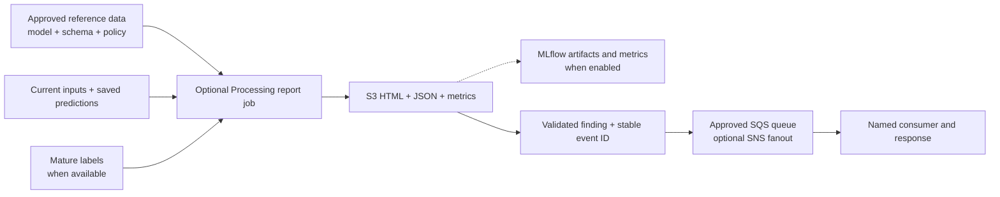

# After the first handoff — integration and platform plan

The first handoff gives the receiving team source, diagrams and instructions for
using its working training/Registry/batch-inference deployment. Testing and code
review begin with that baseline while platform and feature integration proceed.
Return to the [application README](../../README.md) for the operator walkthrough.

This is the proposed plan for the remaining three weeks, starting October 19,
2026. Confirm priorities, named owners, capacity and dates together. The full
list remains visible; it does not imply that every production dependency can be
completed within the engagement.

## First handoff and subsequent changes

| Stage | Outcome | Completion evidence |
| --- | --- | --- |
| First handoff | Team can understand and test the existing published pipelines and read the matching source | Receiving engineer follows an execution to Registry/S3, inspects a step's code/logs and records findings |
| Basic tracking activation | Accepted service, clients and identities; optional source enabled through a planned publication | Actual target notebook/job logging and human UI/report access |
| Tracking completion | Per-run S3 artifact index and automatic terminal-state synchronization | Fresh/cached runs and success/failure/stop/retry show the correct producers and final state without manual notebook sync |
| Monitoring reports | Reusable Evidently reports with agreed baselines, labels, segments and policy | Correct HTML/JSON/metrics for the intended model tasks, including missing-evidence cases |
| Alert handoff | Findings reach an owned queue and consumer | Correlated receipt/acknowledgement, duplicate handling and replay from a saved report |
| Remaining agreed integration | Prioritized HPO/final training, Feature Store, container/release and downstream work | Acceptance recorded for each selected item; remaining gates have owners |

The first handoff includes basic optional MLflow code with `tracking_uri` blank.
Keeping that code does not require immediate service activation. The runtime
temporary-directory fix and producer/evaluation records are useful independently.
Source review/commit, pipeline publication and container build remain separate
operations; first-handoff users enter through the existing deployment.

## Can tracking be usable next week?

The target is **usable tracking during the week of October 26**, subject to the
platform team's confirmation. A service ARN alone is not the acceptance result.
The actual notebook, managed jobs and human viewer must each work from their
approved environment.

Two provisioning routes can satisfy the request:

1. The platform team creates/configures the approved service and returns its
   bindings plus the required caller access.
2. The platform team delegates scoped creation/configuration permissions to the
   agreed development operator, with the approved service role, storage,
   encryption, network and lifecycle policy.

An approved existing service can be reused if its access boundary is suitable.
The current source was exercised with an MLflow 3.0 Tracking Server and pinned
clients. The same runtime accepts MLflow App ARNs. Follow the
[App setup and acceptance guide](mlflow-app.md) for caller permissions, direct
S3 artifact access, notebook configuration and managed-job verification.
Service selection and provisioning method are platform decisions.

| Required result | Proposed responsible role/team | Evidence to return |
| --- | --- | --- |
| Service choice and readiness date | Platform owner | Offering, Region/account, ARN, version and create/reuse route |
| Artifact storage and encryption | Platform/storage owner | S3 prefix, KMS key/policy, retention and service role |
| Notebook and job access | IAM/platform owner with ML developer | Caller ARNs; successful preflight and managed job-role tracking |
| Human UI and report access | Studio/IAM owner | Fresh UI launch and artifact download as the intended viewer |
| Compatible image and scratch | Container/build owner | Approved image digest/client versions; non-root TMPDIR/cache writes |
| Network access | Network/platform owner | Required AWS service connectivity from the actual job environment |
| Availability and cost | Service operator | Startup/availability, maintenance, budget, retention and restart ownership |
| Activation | ML developer/release owner | Accepted source/configuration and deliberately published pipeline version |

For a Tracking Server, UI entry requires the distinct
`sagemaker-mlflow:AccessUI` permission, which has no server-resource scope.
Request its approved regional scope explicitly while keeping experiment/run
reads scoped to the server. Notebook success does not prove job or viewer access.
Apps use `sagemaker:CallMlflowAppApi` on the App ARN and
`sagemaker:CreatePresignedMlflowAppUrl` for UI launch. The notebook/job client
also needs direct access to its experiment's S3 artifact location.

If tracking is not ready, continue baseline testing and report implementation.
The planned Evidently runner can write HTML/JSON to S3 independently of MLflow;
MLflow publication is an optional attachment. This fallback requires the new
report implementation, not a configuration claim about the old demo scripts.

## Tracking completion

**Per-run S3 index:** place a small index in each model run directory linking the
current execution, registered version, MLflow run when present, reports and
actual producing artifacts. Cached outputs retain their original locations.
Failure/partial-output records must remain understandable.

**Terminal synchronization:** terminal means Succeeded, Failed or Stopped.
The current closing tracking job runs before its pipeline is terminal; an earlier
failure can prevent that job from running. The existing synchronization function
can reconcile later, but automatic invocation is missing.

Propose a pipeline-status EventBridge rule and a worker that calls the existing
synchronization function after re-reading the actual execution. Update final
status, timestamps/failure details and the run index. Cover Studio launches and
scheduler launches, same-execution retries, duplicate/out-of-order events, service
outages and operator replay. These are post-handoff implementation tasks.

## Evidently implementation

The demonstrated reports use Evidently 0.7.20 plus a custom Python/Plotly overview.
Reuse the proven report calculations and presentation, replacing fixed example
inputs with explicit model/batch bindings. The customer approves the dependency
set and its operation inside the approved environment.

| Work | Implementation | Owner input / acceptance |
| --- | --- | --- |
| Report runner | Optional Processing entrypoint using existing source/input/output conventions and an approved image | Image/dependency approval, writable scratch and report S3/KMS access |
| Data quality and drift | Validate schema/nulls/types; compare explicit reference/current feature and prediction distributions with suitable numeric/categorical methods | Monitored columns, baseline/model version, windows and thresholds |
| Model quality | Join saved predictions to outcomes by ID/time; support classification metrics and separately validated regression errors/residuals | Score/target mapping, correct units, label source and maturity, real evaluation contract |
| Segments and comparison | Configure segments/minimum support and comparable windows; use paired methods only when observations are actually paired | Agreed segments, minimum evidence and policy limits |
| Missing or late labels | Produce input drift now; record quality unavailable; evaluate the same saved predictions once outcomes arrive | Label delivery owner, coverage/timing and later evaluation trigger |
| Presentation and tracking | Adapt the overview and detailed HTML/JSON/CSV; add HTML/report discovery and metric mapping to the collector | Actual report rendering and matching S3/MLflow outputs |
| Rules and event publishing | Persist report/decision, produce an event with report links and publish to the approved destination | Agreed trigger/severity, publisher identity and response owner |

The controlled demo compared the same customers under deliberately changed
inputs. Production reference/current periods may contain different customers.
Agree comparability and label timing before interpreting a change as model
deterioration. The demo's activity bands, 0.5 classification threshold and
0.05 AUC-drop rule are examples, not accepted business policy.

Use real held-out evaluation for training quality. The template's
`prepared_input_smoke_check` verifies execution, not model acceptance.
Classification reports must show operational metrics such as recall/selected
volume as well as AUC. Missing labels, too few samples or one-class segments
produce explicit insufficient-evidence results.

The implementation belongs mainly in the pipeline builder, a small reporting
entrypoint/runtime, output/tracking collection and configuration. Preserve
adapted training/prediction algorithms; add only the necessary saved-output
adapters. Keep reporting usable with tracking disabled.

## Basic alerts and operations

Start with one approved SQS queue and a named consumer. Use an existing SNS topic
when the platform wants multiple subscribers. Scope the publisher to SendMessage
on that queue or Publish on that topic; SNS→SQS also needs the matching queue
policy. Agree encryption, visibility, retention and dead-letter/replay ownership.

Send a compact event containing model/environment, batch/execution identity,
rule/version/observed value, stable event ID and report URI/checksum. Reports
remain in S3. Save the decision before sending so a delivery failure can be
retried without another model execution. The consumer must handle duplicates.

An SQS message is the initial integration handoff. Human notification, incident
creation or another workflow belongs to the named consumer. Agree that action
and demonstrate a correlated receipt/acknowledgement.

## Wider requirements to coordinate

| Item | Remaining decision or work | Proposed owner |
| --- | --- | --- |
| First-handoff model acceptance | Record supported model/runtime/input/output results and receiving-engineer feedback | Model owners + ML lead |
| Permanent image compatibility | Pin/test Python, AutoGluon, SHAP, XGBoost and NumPy; replace temporary compatibility code after acceptance | Container/build team |
| HPO and final training | Validation objective/search budget, compatible trial startup/artifact collection, trial tracking and explicit prior-metadata/final-fit contract | Model owners + ML lead + platform |
| Feature Store | Source/export readiness, ingestion ownership, offline delivery/catalog grants, keys and training-data reconstruction | Data owner + ingestion operator + platform |
| Native Batch Transform | Accept the intended image/server/model-output behavior and permissions if selected | Model owner + container/platform |
| Scheduling and completion | Choose existing orchestrator, execution identity, request/retry/version contract and completion-worker hosting | Operations/platform |
| CI/CD and promotion | Confirm repository/review/build/deploy route, immutable source/image artifacts, environment bindings and approval/rollback owners | DevOps/platform + model approver |
| Prediction consumers | Agree final schema, destination, delivery timing and acknowledgement | Downstream application/data owner |
| Operating handoff | Logs, failure recovery, resource/data retention, availability/cost and support owner | Operations + ML lead |

## Proposed three-week sequence

| Period | Focus | Decision gate |
| --- | --- | --- |
| October 19–23 | First handoff, team testing/code walkthrough; assign platform/model/data owners; confirm service provision/reuse route; prepare report and tracking-completion code | Named owners, agreed scope, actual bindings and target readiness dates |
| October 26–30 | Activate tracking if ready; exercise index/final-status handling and Evidently against agreed inputs; progress selected HPO/Feature Store/image work in parallel | Target service access and image/data availability; accept working results separately |
| November 2–6 | Prove queue/consumer integration, retry/failure cases and another operator's workflow; finish prioritized integrations and document remaining gates | Accepted scope and evidence, receiving ownership and explicit follow-on list |

These are proposed work windows. At the first walkthrough, select the outcomes
that fit the remaining capacity and identify work owned by other teams.
Service access, labels, approved images and consumer readiness can constrain
different capabilities independently.

## Decisions for the walkthrough

Use the working pipeline as the anchor. Record a named owner, target date and
acceptance evidence for each decision in the receiving team's tracker.

1. Which pipeline versions/model cases form the first accepted baseline, and who
   will test them after the walkthrough?
2. Who will provide or provision MLflow, which offering will be used, and can the
   actual notebook/job/viewer paths be accepted for the week of October 26?
3. Who owns the image/dependency update and the service/network/IAM changes?
4. Which baseline, model-quality outputs, labels/windows, segments and thresholds
   should Evidently implement first?
5. Which queue/topic and consumer own the first alert, and what action follows it?
6. Which HPO, Feature Store, container, release and operating outcomes are required
   during the remaining three weeks, and which need a separately owned follow-up?

Leave with an agreed baseline/test owner, a service readiness date, a bounded
report/alert scope and the prioritized dependency list. The repository contains
the generic implementation; customer code, data, environment values and evidence
stay inside the receiving environment.

## Technical references

- [MLflow setup and offering choice](https://docs.aws.amazon.com/sagemaker/latest/dg/mlflow-app-setup.html)
- [Tracking Server IAM](https://docs.aws.amazon.com/sagemaker/latest/dg/mlflow-create-tracking-server-iam.html)
- [MLflow action resource scopes](https://docs.aws.amazon.com/service-authorization/latest/reference/list_sagemaker-mlflow.html)
- [Pipeline status events](https://docs.aws.amazon.com/sagemaker/latest/dg/automating-sagemaker-with-eventbridge.html)
- [SNS to SQS permissions](https://docs.aws.amazon.com/sns/latest/dg/subscribe-sqs-queue-to-sns-topic.html)
- [SQS duplicate-delivery behavior](https://docs.aws.amazon.com/AWSSimpleQueueService/latest/SQSDeveloperGuide/standard-queues-at-least-once-delivery.html)
