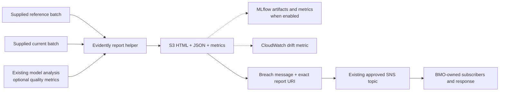

# After the first handoff — integration and platform plan

The first handoff gives the receiving team source, diagrams and instructions for
using its working training/Registry/batch-inference deployment. Testing and code
review begin with that baseline while platform and feature integration proceed.
Return to the [application README](../../README.md) for the operator walkthrough.

This is the proposed plan for the remaining three weeks, starting October 19,
2026. Confirm priorities, named owners, capacity and dates together. The full
list remains visible; it does not imply that every production dependency can be
completed within the engagement.

## First handoff and subsequent changes

| Stage | Outcome | Completion evidence |
| --- | --- | --- |
| First handoff | Team can understand and test the existing published pipelines and read the matching source | Receiving engineer follows an execution to Registry/S3, inspects a step's code/logs and records findings |
| Basic tracking activation | Accepted service, clients and identities; optional source enabled through a planned publication | Actual target notebook/job logging and human UI/report access |
| Tracking completion | Direct job logging, per-run S3 index and caller finalization | Fresh/cached runs retain original producers; notebook/Airflow finalizes after native success/failure/stop |
| Monitoring reports | Evidently data drift, data quality and labelled model-quality comparison | Native HTML/JSON, reference/current metric differences and explicit unavailable quality without labels |
| Alert handoff | Demonstrated message to an approved SNS destination; BMO chooses its receiving workflow | Correlated report/message receipt, with consumer and operating ownership assigned |
| Remaining agreed integration | Prioritized HPO/final training, Feature Store, container/release and downstream work | Acceptance recorded for each selected item; remaining gates have owners |

The first handoff includes basic optional MLflow code with `tracking_uri` blank.
Keeping that code does not require immediate service activation. The runtime
temporary-directory fix and producer/evaluation records are useful independently.
Source review/commit, pipeline publication and container build remain separate
operations; first-handoff users enter through the existing deployment.

## Can tracking be usable next week?

The target is **usable tracking during the week of October 26**, subject to the
platform team's confirmation. A service ARN alone is not the acceptance result.
The actual notebook, managed jobs and human viewer must each work from their
approved environment.

Two provisioning routes can satisfy the request:

1. The platform team creates/configures the approved service and returns its
   bindings plus the required caller access.
2. The platform team delegates scoped creation/configuration permissions to the
   agreed development operator, with the approved service role, storage,
   encryption, network and lifecycle policy.

An approved existing service can be reused if its access boundary is suitable.
The current source was exercised with an MLflow 3.0 Tracking Server and a
SageMaker MLflow 3.10.1 App using compatible pinned clients. Follow the
[App setup and acceptance guide](mlflow-app.md) for caller permissions, direct
S3 artifact access, notebook configuration and managed-job verification.
Service selection and provisioning method are platform decisions.

| Required result | Proposed responsible role/team | Evidence to return |
| --- | --- | --- |
| Service choice and readiness date | Platform owner | Offering, Region/account, ARN, version and create/reuse route |
| Artifact storage and encryption | Platform/storage owner | S3 prefix, KMS key/policy, retention and service role |
| Notebook and job access | IAM/platform owner with ML developer | Caller ARNs; successful preflight and managed job-role tracking |
| Human UI and report access | Studio/IAM owner | Fresh UI launch and artifact download as the intended viewer |
| Compatible image and scratch | Container/build owner | Approved image digest/client versions; non-root TMPDIR/cache writes |
| Network access | Network/platform owner | Required AWS service connectivity from the actual job environment |
| Availability and cost | Service operator | Startup/availability, maintenance, budget, retention and restart ownership |
| Activation | ML developer/release owner | Accepted source/configuration and deliberately published pipeline version |

For a Tracking Server, UI entry requires the distinct
`sagemaker-mlflow:AccessUI` permission, which has no server-resource scope.
Request its approved regional scope explicitly while keeping experiment/run
reads scoped to the server. Notebook success does not prove job or viewer access.
Apps use `sagemaker:CallMlflowAppApi` on the App ARN and
`sagemaker:CreatePresignedMlflowAppUrl` for UI launch. The notebook/job client
also needs direct access to its experiment's S3 artifact location.

If tracking is not ready, continue baseline testing. The included monitoring
helper writes HTML/JSON locally and can upload it to S3 independently of MLflow.
MLflow publication is optional.

## Tracking completion

**Per-run S3 index:** tracking now writes a small index in each model run directory linking the
current execution, registered version, MLflow run when present, reports and
actual producing artifacts. Cached outputs retain their original locations.
Failure/partial-output records must remain understandable.

**Terminal synchronization:** existing model jobs log directly to one MLflow run
per pipeline execution. They leave it open while SageMaker runs. The notebook or
Airflow caller invokes `sync_execution` after the native execution reaches
Succeeded, Failed or Stopped. It finalizes status and links cached outputs to
their original producers. No tracking-only Processing job or completion Lambda
is deployed. A Studio UI launch also needs the notebook's finalization cell or
an equivalent caller action after completion.

See [metrics and completion](observability.md) for the caller function and the
prediction-analysis metric file format. Customer preprocessing, split/held-out
modeling logic and deeper dataset identity stay with their owners.

## Minimal Evidently implementation

The included [monitoring example](observability.md#run-the-small-monitoring-example)
uses Evidently 0.7.20. Notebook 04 runs a synthetic unchanged/shifted comparison,
then optionally runs one monitoring Processing job using the same approved image
as training and inference. Replace those frames with supplied
reference/current batches and agree the monitored columns and thresholds.

| Work | Included pattern | BMO input / extension |
| --- | --- | --- |
| Batch comparison | Explicit numerical/categorical columns, PSI scores and configurable drift share | Appropriate reference windows, inputs and thresholds |
| Model quality | Native binary-classification/regression reports and current-minus-reference metric differences; absent labels remain unavailable | Aligned predictions/labels, model-specific metrics and segment analysis |
| Report visibility | HTML/JSON/summary/metrics in S3 and optionally MLflow | Approved destinations, service access and retention |
| Alert signal | Optional CloudWatch metric, one alarm example or a direct SNS breach message | Response policy, subscribers, ongoing report lookup and operating process |
| Execution | Callable helper and one monitoring Processing job using the shared image | Schedule/orchestrator and approved job-role access |

Feature drift is a review signal. It does not establish model-quality degradation.
Training's `prepared_input_smoke_check` also remains a workflow check; real
held-out validation, preprocessing and feature overrides stay with the model
owners. No broader dataset-identity framework is added.

This pattern does not configure a native SageMaker Model Monitor schedule.
If that is required for final acceptance, agree its owner and separate deployment.

## Basic alerts and operations

The example sends to one existing approved SNS topic. The message carries the
report URI, model/batch context, drifted columns and metrics. S3 retains the report
before notification. A receiving process can deduplicate on `summary_uri`.

BMO chooses the subscription and what happens next: for example, an SQS queue
and consumer, email routing or an existing incident workflow. The application
does not create that response system. Agree the owner, policy, retention and
replay approach when connecting it. The sandbox demonstration uses a temporary
SNS/SQS destination solely to verify the correlated receipt.

## Wider requirements to coordinate

| Item | Remaining decision or work | Proposed owner |
| --- | --- | --- |
| First-handoff model acceptance | Record supported model/runtime/input/output results and receiving-engineer feedback | Model owners + ML lead |
| Pinned model runtime | Use the tested requirements/lock and image digest; accept actual model outputs and agree dependency-upgrade notification, validation and rollback | Container/build team + model owners |
| HPO and final training | Validation objective/search budget, compatible trial startup/artifact collection, trial tracking and explicit prior-metadata/final-fit contract | Model owners + ML lead + platform |
| Feature Store | Source/export readiness, ingestion ownership, offline delivery/catalog grants, keys and training-data reconstruction | Data owner + ingestion operator + platform |
| Native Batch Transform | Accept the intended image/server/model-output behavior and permissions if selected | Model owner + container/platform |
| Scheduling and completion | Choose existing orchestrator, execution identity, request/retry/version contract and completion-worker hosting | Operations/platform |
| CI/CD and promotion | Confirm repository/review/build/deploy route, immutable source/image artifacts, environment bindings and approval/rollback owners | DevOps/platform + model approver |
| Prediction consumers | Agree final schema, destination, delivery timing and acknowledgement | Downstream application/data owner |
| Operating handoff | Logs, failure recovery, resource/data retention, availability/cost and support owner | Operations + ML lead |

## Proposed three-week sequence

| Period | Focus | Decision gate |
| --- | --- | --- |
| October 19–23 | First handoff, team testing/code walkthrough; assign platform/model/data owners; confirm service provision/reuse route; prepare report and tracking-completion code | Named owners, agreed scope, actual bindings and target readiness dates |
| October 26–30 | Activate tracking if ready; exercise index/final-status handling and Evidently against agreed inputs; progress selected HPO/Feature Store/image work in parallel | Target service access and image/data availability; accept working results separately |
| November 2–6 | Prove queue/consumer integration, retry/failure cases and another operator's workflow; finish prioritized integrations and document remaining gates | Accepted scope and evidence, receiving ownership and explicit follow-on list |

These are proposed work windows. At the first walkthrough, select the outcomes
that fit the remaining capacity and identify work owned by other teams.
Service access, labels, approved images and consumer readiness can constrain
different capabilities independently.

## Decisions for the walkthrough

Use the working pipeline as the anchor. Record a named owner, target date and
acceptance evidence for each decision in the receiving team's tracker.

1. Which pipeline versions/model cases form the first accepted baseline, and who
   will test them after the walkthrough?
2. Who will provide or provision MLflow, which offering will be used, and can the
   actual notebook/job/viewer paths be accepted for the week of October 26?
3. Who owns the image/dependency update and the service/network/IAM changes?
4. Which baseline, model-quality outputs, labels/windows, segments and thresholds
   should Evidently implement first?
5. Which queue/topic and consumer own the first alert, and what action follows it?
6. Which HPO, Feature Store, container, release and operating outcomes are required
   during the remaining three weeks, and which need a separately owned follow-up?

Leave with an agreed baseline/test owner, a service readiness date, a bounded
report/alert scope and the prioritized dependency list. The repository contains
the generic implementation; customer code, data, environment values and evidence
stay inside the receiving environment.

## Technical references

- [MLflow setup and offering choice](https://docs.aws.amazon.com/sagemaker/latest/dg/mlflow-app-setup.html)
- [Tracking Server IAM](https://docs.aws.amazon.com/sagemaker/latest/dg/mlflow-create-tracking-server-iam.html)
- [MLflow action resource scopes](https://docs.aws.amazon.com/service-authorization/latest/reference/list_sagemaker-mlflow.html)
- [Pipeline status events](https://docs.aws.amazon.com/sagemaker/latest/dg/automating-sagemaker-with-eventbridge.html)
- [SNS to SQS permissions](https://docs.aws.amazon.com/sns/latest/dg/subscribe-sqs-queue-to-sns-topic.html)
- [SQS duplicate-delivery behavior](https://docs.aws.amazon.com/AWSSimpleQueueService/latest/SQSDeveloperGuide/standard-queues-at-least-once-delivery.html)
